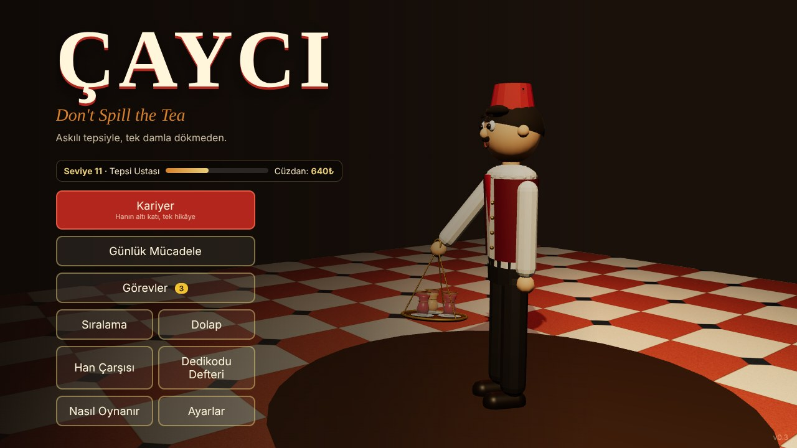

# ÇAYCI — Don't Spill the Tea

Askılı çay tepsisiyle, tek damla dökmeden İstanbul'daki eski bir hanın altı katına çay yetiştirdiğin, fizik tabanlı bir risk-ödül oyunu. Sürüm **0.3**.



- **Tasarım belgesi:** [docs/TASARIM.md](docs/TASARIM.md) (kurgu, oynanış, ilerleme sistemi, denge ölçümleri, yol haritası)
- **Demo görselleri:** [docs/gorseller/](docs/gorseller/)
- **Steam yayın kiti:** [steam/STORE.md](steam/STORE.md) (mağaza metni TR/EN, kapaklar, ekran görüntüleri, başarımlar, kontrol listesi)

## Oyun

Tepsiye istediğin kadar bardak koy: çok bardak çok bahşiş, ama tepsi ağırlaştıkça huysuzlaşır ve 6 bardaktan sonra kule başlar. Bahşişler tepsideki kavanozda durur, ancak ocağa dönünce kasaya geçer. Tepsi uçarsa kavanozdaki para da gider.

- **Kariyer:** 6 mekân (Giriş Salonu → Zemin Kat → 1. Kat → 2. Kat → 3. Kat → Teras). Her mekânın kendi engeli (kalabalık, paspaslı ıslak zemin, açık/demli siparişler, kedi Paşa, elektrik kesintisi, rüzgâr), iki görevi, üç yıldızı ve yenilecek rakipleri var. Bir mekânda 1 yıldız sonrakini açar.
- **Hikâye:** VIP siparişlerini eksiksiz götürdükçe müşteriler dedikodu anlatır. 12 dedikodudan 10'unu topla, terastaki han toplantısında hanın kaderine karar ver (3 son).
- **Günlük Mücadele:** Her gün herkese aynı mekân ve aynı tohum, yükseltmeler kapalı.
- **İlerleme:** XP ve 30 seviye, 7 rütbe, seviyeyle açılan kıyafetler (dolap), bahşişle alınan yükseltmeler (çarşı), her gün 3 yeni görev, 21 başarım, mekân ve gün başına yerel sıralama.

## Çalıştırma

Gerekenler: [Node.js](https://nodejs.org) 20 veya üstü (ücretsiz).

```bash
cd cayci-oyun
npm install
npm run dev        # tarayıcıda http://localhost:5173 açılır
```

| Komut | Ne yapar |
|---|---|
| `npm run dev` | Geliştirme sunucusu, kod değişince sayfa yenilenir |
| `npm run build` | Tip kontrolü + `dist/` klasörüne yayın derlemesi |
| `npm test` | Fizik, harita, ilerleme, görev, başarım ve sıralama birim testleri |
| `npm run smoke` | Bütün kariyeri (6 mekân → han toplantısı → son), günlük mücadeleyi ve menüleri başsız tarayıcıda uçtan uca dener |
| `npm run balance` | Denge botu her mekânda 5 farklı oyuncu tipiyle oynar, skor dağılımını ve görev tamamlanma oranlarını yazar |
| `npm run shots` | Demo görsellerini `shots/` klasörüne çeker (`W=1920 H=1080 LANG_ID=en` ile mağaza boyutu ve İngilizce) |
| `npm run steam:capsules` | Steam kapak görsellerini `steam/capsules/` içine çizer |
| `npm run steam:kit` | Başarım listesini ve ikonlarını koddan üretir |
| `npm run tune` | Yürüme/koşma/duruş senaryolarında ne kadar çay döküldüğünü yazar |

## Kontroller

| Klavye / fare | Oyun kolu | Eylem |
|---|---|---|
| W A S D | Sol çubuk | Yürü |
| Fare | Sağ çubuk | Bak, dön |
| Shift | RB | Koş (tepsi daha çok sallanır) |
| Ctrl / C | LB | Parmak ucunda yürü: yavaş ama güvenli, kedi takılmaz, ıslak zeminde kaymazsın |
| E (ocakta basılı) | A | Demli çay doldur |
| Q (ocakta basılı) | X | Açık çay doldur (1. kattan itibaren) |
| E (masada) | A | Teslim et |
| F, sonra yeşilde F | B | Fırıldak: tutarsa sonraki teslim ×2 |
| Boşluk | Y | Tepsiyi kaldır |
| Sol tık basılı + fare | | Ustalar için: eli kendin döndür |
| Esc | Start | Duraklat |

## Teknoloji

- **TypeScript + Three.js + Vite.** Hepsi MIT lisanslı, ücretsiz, gelir payı yok.
- **Sıfır dış varlık:** Bütün 3B modeller (`src/world/models.ts`), dokular (`src/world/textures.ts`), sesler ve Hicaz makamındaki müzik (`src/audio/Audio.ts`) koddan üretiliyor. İndirilmiş tek bir dosya yok, lisans riski yok.
- **Fizik:** `src/physics/tray.ts` askılı tepsiyi sarkaç, çay yüzeyini çalkalanan bir yay, kavanozu ve kulenin üst katını ağır sönümlü katı cisim olarak simüle eder. Ayar sayılarının hepsi `src/config.ts` içinde.
- **Denge botu:** `src/dev/bot.ts` oyunu gerçek kurallar ve fizikle oynar (tek hilesi nişan almak). Yıldız eşikleri, rakip skorları, görev hedefleri ve ekonomi bu ölçümlere göre ayarlandı.

## Steam sürümü (masaüstü)

`desktop/` klasörü oyunu Electron ile Windows/Linux/Mac uygulamasına sarar ve [steamworks.js](https://github.com/ceifa/steamworks.js) ile Steam'e bağlar: başarımlar, Steam Cloud kaydı ve Steam oyuncu adı. **Bu klasör bu geliştirme ortamında hiç çalıştırılmadı** (Electron indirmesi ağ kısıtına takıldı); kendi bilgisayarında denemen gerekiyor:

```bash
npm run build                 # önce web derlemesi
cd desktop
npm install
echo 480 > steam_appid.txt    # Steam App ID'ni alınca 480 yerine onu yaz
npm start                     # masaüstünde dene
npm run dist                  # out/ klasörüne paketle → Steamworks'e yükle
```

Not: steamworks.js 0.4 Steam Leaderboards desteklemiyor. Oyundaki sıralama şimdilik cihazdaki yerel sıralama.

## Klasör yapısı

```
src/
  config.ts        bütün ayar sayıları
  core/            girdi (klavye, fare, oyun kolu), dil (TR/EN), kayıt, Steam köprüsü, tohumlu rastgele sayı
  physics/         tepsi simülasyonu, Fırıldak, ızgara çarpışması ve yol bulma
  game/            mekânlar, hikâye, kat haritaları, bahşiş kuralları, vardiya sahnesi (Run.ts)
  meta/            XP/seviye, kozmetik, yükseltme, günlük görevler, başarımlar, sıralama, tur sonu işleme
  world/           modeller, dokular, ışık ve gökyüzü, kat inşası
  entities/        Cemal, han sakinleri, müşteriler, Paşa, tepsi görünümü
  fx/              damlalar, cam kırıkları, buhar, gölcükler
  audio/           ses sentezi ve müzik
  ui/              HUD, menüler, stiller
  dev/             denge botu, tanıtım sahneleri
tests/             vitest birim testleri
scripts/           duman testi, demo görselleri, denge ölçümü, Steam kiti üreticileri
desktop/           Electron + Steam sarmalayıcı
steam/             mağaza metni, kapaklar, ekran görüntüleri, başarımlar
docs/              tasarım belgesi ve görseller
```
