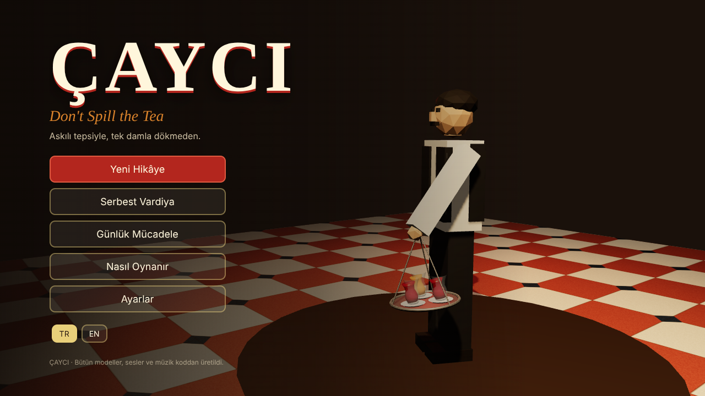

# ÇAYCI — Don't Spill the Tea

Askılı çay tepsisiyle, tek damla dökmeden İstanbul'un en kaotik iş hanına çay yetiştirdiğin fizik tabanlı bir komedi oyunu.



- **Tasarım belgesi:** [docs/TASARIM.md](docs/TASARIM.md) (kurgu, karakterler, oynanış, ses, görsel, yol haritası)
- **Demo görselleri:** [docs/gorseller/](docs/gorseller/)

## Modlar

- **Açgözlü Çaycı (ana mod):** 90 saniye. Tepsiye istediğin kadar bardak koy; çok bardak çok bahşiş ama tepsi huysuzlaşır. Bahşişler tepsideki kavanozda durur, ocağa dönünce kasaya geçer. Tepsi uçarsa kavanoz da gider.
- **Hikâye:** 5 gün, 5 kat, dedikodu kartları ve 3 son.
- **Serbest Vardiya** ve **Günlük Mücadele**.

## Çalıştırma

Gerekenler: [Node.js](https://nodejs.org) 20 veya üstü (ücretsiz).

```bash
cd cayci-oyun
npm install
npm run dev        # tarayıcıda http://localhost:5173 açılır
```

| Komut | Ne yapar |
|---|---|
| `npm run dev` | Geliştirme sunucusu, kod değişince sayfa yenilenir |
| `npm run build` | Tip kontrolü + `dist/` klasörüne yayın derlemesi (itch.io'ya bu klasörü zip'leyip yükle) |
| `npm test` | Fizik, bahşiş kuralları ve 5 kat haritası için birim testleri |
| `npm run tune` | Yürüme/koşma/duruş senaryolarında ne kadar çay döküldüğünü yazdırır (dengeleme) |
| `npm run shots` | Oyunu başsız Chromium'da açıp `shots/` klasörüne demo görselleri çeker |
| `npm run smoke` | Hikâyenin tamamını (5 gün → final) ve ses motorunu uçtan uca dener |

## Kontroller

| Tuş | Eylem |
|---|---|
| W A S D | Yürü |
| Fare | Bak / dön |
| Shift | Koş (tepsi daha çok sallanır) |
| Sol tık basılı + fare | Kol modu. Fareyle **hızlı daireler** çiz → Fırıldak (360°) |
| Boşluk | Tepsiyi kaldır |
| 1 / 2 (ocakta, basılı tut) | Açık / demli çay doldur, renk hedefteyken bırak |
| Q (ocakta) | Tepsiyi boşalt |
| E | Teslim et |
| F | "Çaaay!" diye bağır |
| Esc | Duraklat |

## Teknoloji

- **TypeScript + Three.js + Vite.** Hepsi MIT lisanslı, ücretsiz, gelir payı yok.
- **Sıfır dış varlık:** Bütün 3D modeller (`src/world/models.ts`), dokular (`src/world/textures.ts`), sesler ve Hicaz makamındaki müzik (`src/audio/Audio.ts`) koddan üretiliyor. İndirilmiş tek bir dosya yok, lisans riski yok.
- **Fizik:** `src/physics/tray.ts` askılı tepsiyi sarkaç, çay yüzeyini çalkalanan bir yay olarak simüle eder. Ayar sayılarının hepsi `src/config.ts` içinde.
- Bütün oyun gzip ile ~165 KB.

## Steam sürümü (masaüstü)

`desktop/` klasörü oyunu Electron ile Windows/Linux/Mac uygulamasına sarar ve [steamworks.js](https://github.com/ceifa/steamworks.js) ile Steam'e bağlar. Bu klasör kendi bilgisayarında çalıştırılmak içindir (Electron'u GitHub'dan indirir):

```bash
npm run build                 # önce web derlemesi
cd desktop
npm install
echo 480 > steam_appid.txt    # Steam App ID'ni alınca 480 yerine onu yaz
npm start                     # masaüstünde dene
npm run dist                  # out/ klasörüne paketle → Steamworks'e yükle
```

## Klasör yapısı

```
src/
  config.ts        bütün ayar sayıları
  core/            girdi, dil (TR/EN), kayıt, tohumlu rastgele sayı
  physics/         tepsi simülasyonu, ızgara çarpışması ve yol bulma
  game/            hikâye, kat haritaları, sipariş kuralları, vardiya sahnesi
  world/           modeller, dokular, kat inşası
  entities/        Cemal, NPC'ler, müşteriler, Paşa, tepsi görünümü
  fx/              damlalar, cam kırıkları, buhar, gölcükler
  audio/           ses sentezi ve müzik
  ui/              HUD, menüler, stiller
tests/             vitest birim testleri
scripts/           demo görseli, duman testi, dengeleme araçları
desktop/           Electron + Steam sarmalayıcı
docs/              tasarım belgesi ve görseller
```
